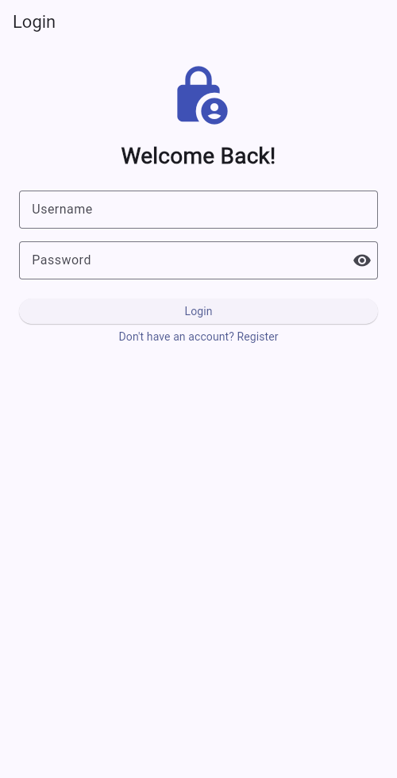
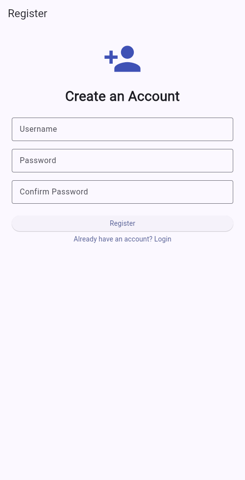
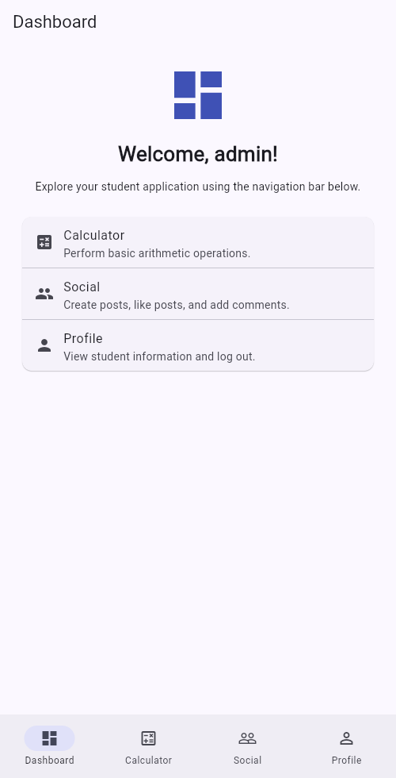
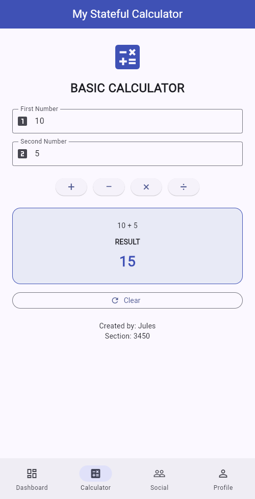
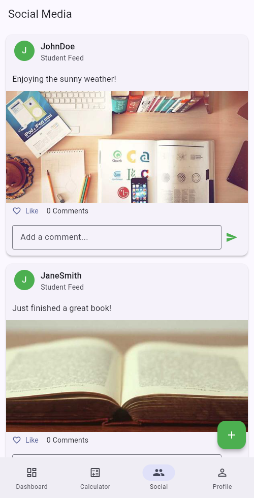
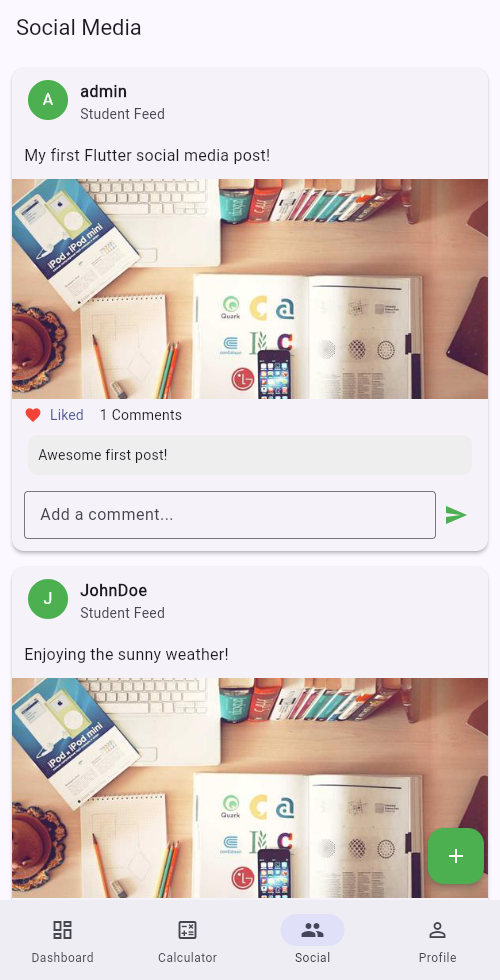
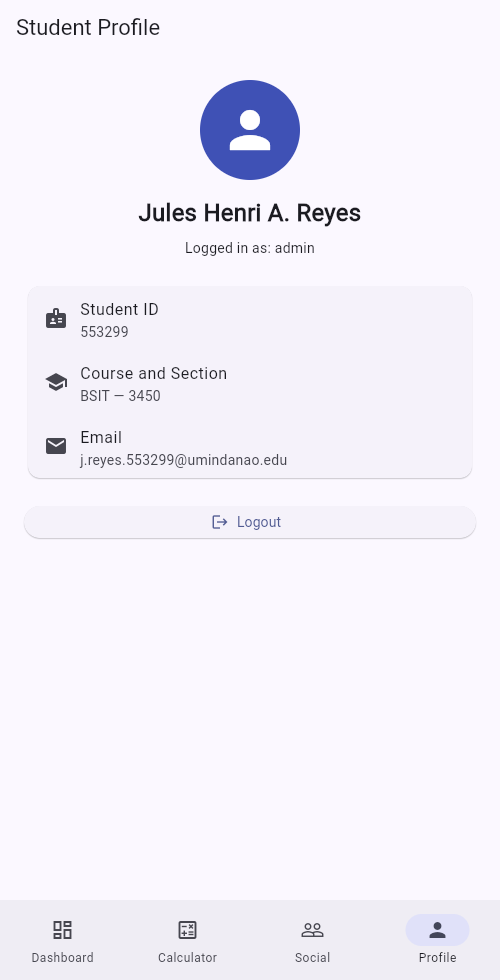

# Demo Authentication, StatefulWidget, and Bottom Navigation

**Name:** Jules Henri A. Reyes  
**Student ID:** 553299  
**Course & Section:** BSIT - 3450  
**GitHub Repository:** https://github.com/JulesHenriReyes/reyes_navigation_app  

---

## 1. Login and Register Screens

### Login Screen
The application opens on `LoginScreen`, which validates non-empty inputs and checks credentials using `DemoAuth.login()`, replacing the route with `MainScreen` on success.

### Register Screen
`RegisterScreen` enforces username length (>= 3, rejecting `admin`), password length (>= 6), and matching Confirm Password before calling `DemoAuth.register()` and returning to Login.

---

## 2. Dashboard Page

`DashboardPage` receives the active `username` from `MainScreen` and displays `Welcome, admin!` alongside overview cards for Calculator, Social, and Profile.

---

## 3. Calculator Page

`CalculatorScreen` provides two numeric input fields, `+`, `−`, `×`, and `÷` buttons, result display (`10 + 5 = 15.0`), input validation, division-by-zero handling, and a Clear button.

---

## 4. Social Page (Feed & Post Interaction)

### Social Feed
`SocialMediaPage` displays initial sample posts (`JohnDoe` and `JaneSmith`) in a `ListView.builder` and opens `CreatePostSheet` via the green `+` button.

### Post with Logged-in Username, Like, and Comment
A newly created post appears at the top of the feed displaying the logged-in username (`admin`), active `Liked` state, and an added comment updating the counter.

---

## 5. Profile Page

`ProfilePage` displays fixed student information alongside the dynamic `Logged in as: $username` label and a **Logout** button that calls `DemoAuth.logout()` and clears the route stack back to `LoginScreen`.

---

## 6. Testing Table (Step 11)

| No. | Test | Expected Result | Pass/Fail |
| --- | --- | --- | --- |
| 1 | Open the application. | Login appears first. | Pass |
| 2 | Submit empty login fields. | Validation messages appear. | Pass |
| 3 | Enter incorrect credentials. | Login is rejected. | Pass |
| 4 | Enter `admin` / `admin123`. | Dashboard opens. | Pass |
| 5 | Read the dashboard greeting. | Displays `Welcome, admin!` | Pass |
| 6 | Open Calculator and calculate `10 + 5`. | Displays `15.0`. | Pass |
| 7 | Switch tabs and return to Calculator. | Inputs and result remain. | Pass |
| 8 | Create a social post. | Post displays the logged-in username. | Pass |
| 9 | Like a post and add a comment. | Both interactions update correctly. | Pass |
| 10 | Switch tabs and return to Social. | Posts, likes, and comments remain. | Pass |
| 11 | Open Profile. | Student information and username appear. | Pass |
| 12 | Tap Logout. | Login appears; Back does not reopen MainScreen. | Pass |
| 13 | Register a valid account and log in. | Dashboard displays the registered username. | Pass |
| 14 | Create a post using the registered account. | Post displays the registered username. | Pass |

---

## 7. Guide Questions

**1. How does DemoAuth connect Login to Dashboard, Social, and Profile?**  
When `DemoAuth.login()` verifies either the default `admin` account or the registered credentials, it saves the username into the static `DemoAuth.currentUsername` property. When `MainScreen` initializes in `initState()`, it reads `DemoAuth.currentUsername` and passes that username string as a constructor parameter to `DashboardPage`, `SocialMediaPage`, and `ProfilePage`.

**2. Why must the order of pages match the bottom navigation destinations?**  
`NavigationBar` passes the tapped destination's integer `index` (`0` to `3`) to `onDestinationSelected`, which updates `selectedIndex` in `IndexedStack`. Because `IndexedStack` displays the widget at `pages[selectedIndex]`, keeping `pages` and `destinations` in the exact same order ensures tapping each tab displays its matching screen.

**3. Why is IndexedStack useful for the Calculator and Social pages?**  
Unlike swapping widgets directly in `Scaffold.body`, `IndexedStack` keeps all four destination widgets mounted in the widget tree at once while only painting the active child. As a result, `CalculatorScreen` keeps its text fields and result, and `SocialMediaPage` keeps its created posts, likes, and comments when switching tabs.

**4. Why should Logout clear the current username and remove previous routes?**  
Calling `DemoAuth.logout()` sets `currentUsername` back to `null` so the next login session starts cleanly without reusing the previous user's identity. Using `pushAndRemoveUntil(..., (route) => false)` clears `MainScreen` from the navigation stack so pressing the device Back button cannot navigate back into an authenticated session.

**5. Which information is lost when this demo application restarts?**  
Because `DemoAuth` and `SocialMediaPage` store data only in memory without a local database or persistent storage, the registered username and password, `currentUsername` session, newly created posts, likes, and comments are all lost on restart. Only the hardcoded `admin` / `admin123` account and the two default sample posts (`JohnDoe` and `JaneSmith`) remain when the app restarts.
